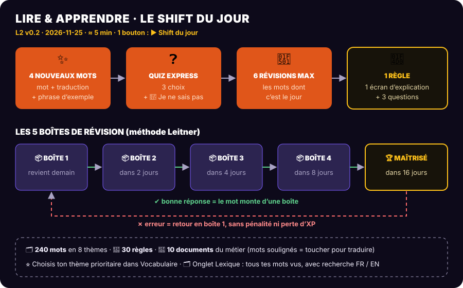

# Grand-Tchoum-Auto-6 · TrioLingo Industrial Edition Pro Max

Apprendre l'anglais d'un **technicien de maintenance en chaîne de production**. Une seule page HTML installable sur téléphone : hors-ligne, **zéro traceur, zéro cookie, zéro compte**.

- **Version courante :** L3 v0.4 · 2026-11-25
- **Pour installer (ami·e, utilisateur·rice) :** [`docs/TrioLingo_Installation_v0.1_2026-11-25.md`](docs/TrioLingo_Installation_v0.1_2026-11-25.md)
- **Pour apprendre :** [`docs/TrioLingo_LireApprendre_v0.2_2026-11-25.md`](docs/TrioLingo_LireApprendre_v0.2_2026-11-25.md)
- **Pour écouter :** [`docs/TrioLingo_Ecouter_v0.4_2026-11-25.md`](docs/TrioLingo_Ecouter_v0.4_2026-11-25.md)

## Les 4 sections
| | Section | Lot |
|---|---|---|
| 📖 | Lire & apprendre : vocabulaire métier, grammaire, révision espacée | L2 ✅ |
| 🎧 | Écouter : briefings, consignes, appels (voix installée sur le téléphone uniquement) | L3 ✅ |
| 🎙 | Parler : modèle, enregistrement, note automatique **sur demande** ou auto-note | L4 |
| 🔧 | Mode mystère **Grand Tchoum Auto 6** : retrouver la douille de 13 (jeu 3D, style console années 2000, 100 % original) | L5–L6 |

---

## Notes de version

### L3 v0.4 · 2026-11-25 · Écouter

- ▶ **Shift d'écoute** (≈ 5 min, 1 bouton) : 1 message du métier + 3 questions, 3 dictées, 4 nombres & heures. Barre « Étape X / N · % ».
- 📻 **12 messages du métier** (6 niveau A2, 6 niveau B1) : briefing sécurité, appel de l'équipe de nuit, accueil de l'hôtel, annonce à l'aéroport, magasin d'outils (la douille de 13…), indications pour l'usine, opérateur qui décrit une panne, appel radio, rappel consignation, message du fournisseur, passation de fin de poste, visite du client. Hauteur de voix différente selon la personne qui parle.
- ✍️ **Dictées** à partir des 240 phrases d'exemple, en priorité avec les mots déjà appris. Indice (1re lettre + nombre de lettres + traduction). 1 lettre d'écart sur un mot de 5 lettres ou plus = juste (« Presque ! »).
- 🔢 **Nombres & heures** tirés au hasard sur les pièges du terrain : 13 / 30, 8:15 / 8:50, 2.5 / 25 bar, tailles de douilles.
- 👁 **Texte du message** disponible si tu bloques, avec les mots du lexique soulignés. Les points d'écoute sont alors divisés par 2 (jamais de perte).
- 📈 La compétence **Écoute** monte enfin avec le travail réel. Nombres et dictées sont plafonnés à 30 points par jour, pour que le niveau reste honnête. L'XP, elle, n'est pas plafonnée.
- 🔒 Toujours **uniquement les voix installées** sur le téléphone. Sans voix : encadré jaune + guide d'installation, boutons grisés.
- 🐞 Correctif : si le téléphone relance la recherche des voix et reçoit une liste vide, la voix déjà trouvée n'est plus effacée.

**Testé** (Chromium, écran 390 × 844, voix anglaise simulée car l'appareil de test n'en a pas) : écran sans voix, Shift d'écoute complet (message, dictée juste, à 1 lettre près, « je ne sais pas », nombres), retour sur Écouter, message avec texte affiché (points ÷ 2 vérifiés), 500 tirages de nombres sans doublon, plafond du jour, sauvegarde après rechargement, puis tous les tests L1, L2 et personnage. Résultat : 0 erreur, **0 requête vers un autre site**.

**Limites connues** : la vraie voix n'a pas pu être écoutée par l'appareil de test (à vérifier sur ton téléphone) ; la qualité de la voix dépend de celle installée sur le téléphone.

### L2 v0.3 · 2026-11-25 · Personnage réaliste
- 👷 **Nouveau personnage plus réaliste** : visage proportionné, yeux détaillés, nez, oreilles, casque de chantier en volume (nervure, visière, reflet, autocollant « 13 »), chemise de travail et gilet haute visibilité avec bandes réfléchissantes.
- 🎨 **Plus de choix** : 6 casques, 2 gilets (jaune fluo, orange), 6 teintes de peau, 4 coiffures (court, long, rasé, bouclé), 6 couleurs de cheveux, 4 barbes (aucune, naissante, barbe, moustache), 4 couleurs d'yeux, lunettes de sécurité. Bouton **🎲 Au hasard**.
- 👀 L'aperçu reste visible en haut de l'écran pendant les choix.
- ♻️ Les profils existants sont **convertis automatiquement** (la couleur du casque et la teinte de peau sont gardées, rien à refaire).

**Testé** : conversion d'un profil L1, création et modification du profil, bouton 🎲, puis tous les tests L1 et L2. Résultat : 0 erreur, 0 requête vers un autre site.

### L2 v0.2 · 2026-11-25 · Lire & apprendre

- ▶ **Shift du jour** (≈ 5 min, 1 bouton) : 4 nouveaux mots, quiz, jusqu'à 6 révisions, 1 règle avec 3 questions. Barre de progression « Étape X / N · % », bouton ✕ pour quitter à tout moment sans rien perdre.
- 🗂 **240 mots métier** en 8 thèmes de 30 : Sécurité, Mécanique, Électricité, Automatisme, Hydraulique & pneumatique, Outils & mesure, Production & qualité, Déplacement & rapports. Chaque mot : traduction, phrase d'exemple du métier, 🔊 si une voix anglaise est installée, note 🇬🇧 quand le mot britannique diffère (wrench / spanner, outlet / socket…).
- 📦 **Révision espacée en 5 boîtes** (1, 2, 4, 8 puis 16 jours). Erreur = retour en boîte 1, **aucune perte d'XP**. Les questions changent avec la boîte : anglais → français, puis français → anglais, puis phrase à compléter.
- 📐 **30 règles** en 1 écran chacune (10 de grammaire, 10 de conjugaison, 10 de syntaxe), 3 questions par règle. Le Shift du jour propose d'abord la compétence la plus faible.
- 📖 **10 documents du métier** (bon de travail, panneau de sécurité, hôtel, e-mail, passation de consignes, consignation, rapport d'intervention, fiche technique, annonce en gare, presque-accident) avec 3 questions chacun. **Les mots du lexique sont soulignés** : un toucher donne la traduction.
- 🗂 **Onglet Lexique** : tous les mots vus, rangés par thème, avec leur boîte (●●○○○) et une recherche FR / EN.
- ⭐ **Thème prioritaire** du Shift, au choix dans Vocabulaire.
- 📈 Les niveaux montent avec le travail réel : vocabulaire (nouveaux mots, révisions, mots maîtrisés), grammaire, conjugaison, syntaxe (règles), lecture (documents). La 1re bonne réponse compte plus que les suivantes.
- ♻️ Les sauvegardes du lot 1 se chargent telles quelles (rien à refaire).

**Testé** (Chromium, écran 390 × 844) : relecture d'une sauvegarde L1, Shift du jour complet, thème (apprendre + réviser), règle, lecture avec glossaire, calcul des boîtes (bonne réponse, erreur, mot maîtrisé, entraînement hors date), lexique et recherche, données gardées après rechargement, export avec les cartes, et tous les tests du lot 1. Résultat : 0 erreur, **0 requête vers un autre site**. Le contenu a aussi été vérifié automatiquement : 30 mots par thème, chaque exemple contient son mot, 3 réponses différentes par question.

**Limites connues** : pas encore essayé sur un vrai téléphone ; prononciation 🔊 seulement avec une voix anglaise installée.

### L1 v0.1 · 2026-11-25 · Le socle
- 🏗 **App installable** (écran d'accueil iPhone et Android) qui marche **sans réseau** une fois ouverte.
- 👷 **Profil local** : prénom ou pseudo, couleur du casque, teinte de peau. Jamais envoyé.
- 🧭 **Test de placement** de 5 min : 18 questions (15 sans voix anglaise), 3 par compétence (facile, moyen, difficile), bouton **« Je ne sais pas »**. Niveaux A1 → B1 au départ. Refaire le test ne fait **jamais baisser** un niveau.
- 📊 **Radar de 7 compétences** : vocabulaire, grammaire, conjugaison, syntaxe, lecture, écoute, oral (« ? » tant que non évalué). XP, niveau de technicien, semaine en flammes 🔥 (un jour sans = 💤, jamais de série perdue).
- 🌐 **Menus FR puis EN** (mode Auto) : les menus passent en anglais vers A2+, tout le reste vers B1. Réglable : Auto / Français / English.
- 🗣 **Voix anglaise** : seules les voix **installées sur le téléphone** sont utilisées (les voix « en ligne » sont ignorées exprès). Guide d'installation si aucune.
- 🎙 **Micro** : réglage du consentement déjà en place (Options → Micro). Message clair avant tout envoi de la voix à Google ou Apple ; Non = auto-note locale.
- 💾 **Export / import** d'un fichier `.json` avec barre de progression. **Copie de secours** automatique avant import, avant effacement, et si la sauvegarde est illisible (jamais d'écrasement silencieux).
- 📲 Rappels : installer l'app (sinon l'iPhone peut effacer les données après 7 jours), exporter au moins 1 fois par semaine.
- 🔧 Sections 1 à 4 : écran « arrive au lot X » ; aperçu visuel du mode mystère.
- 🔒 Verrou de sécurité dans la page : **aucune connexion réseau possible** (`connect-src 'none'`).

**Testé** (navigateur Chromium, écran de téléphone 390 × 844) : démarrage, profil, test complet avec et sans voix, accueil, progrès, lexique, options, export, effacement, import, rechargement **sans réseau**, sauvegarde abîmée (copie de secours créée). Résultat : 0 erreur, **0 requête vers un autre site**.

**Limites connues**
- Pas encore essayé sur un vrai iPhone ni Android.
- Les questions d'écoute dépendent d'une voix anglaise installée sur le téléphone.
- Les sections 1 à 4 sont des écrans d'attente (contenu aux lots 2 à 6).

---

## Décisions de cadrage (2026-11-25)
| # | Sujet | Choix |
|---|---|---|
| D1 | Évaluer l'oral | Reconnaissance du navigateur, **sur demande** (sinon auto-note locale) |
| D2 | Nom du mode 4 | Grand Tchoum Auto 6 : parodie gratuite, jamais vendue, aucun logo/police/perso/carte d'un jeu existant |
| D3 | Niveau de départ | Test de placement 5 min |
| D4 | Anglais | Américain, avec notes UK quand le mot diffère |
| D5 | Interface | Français au début, bascule progressive vers l'anglais |
| D6–D7 | Dépôt | Ce dépôt public : app + jeu |

## Fichiers
| Fichier | Rôle |
|---|---|
| `index.html` | L'app entière (une seule page, aucun fichier externe) |
| `sw.js` | Mode hors-ligne (ne contacte aucun autre site) |
| `manifest.webmanifest`, `icon-*.png`, `apple-touch-icon.png` | Installation sur téléphone |
| `docs/` | Guides pour l'utilisateur (nom, version et date dans le nom de fichier) |

## Mettre en ligne (GitHub Pages)
1. Sur GitHub : **Settings → Pages**.
2. **Source : Deploy from a branch** → branche **`main`** → dossier **`/ (root)`** → **Save**.
3. Attendre 1 à 2 min : le lien s'affiche en haut de la page Pages. C'est ce lien qu'on envoie aux amis.

Mise à jour : remplacer `index.html` et `sw.js` sur `main` ; les téléphones prennent la nouvelle version à la réouverture (1 à 2 fois).
