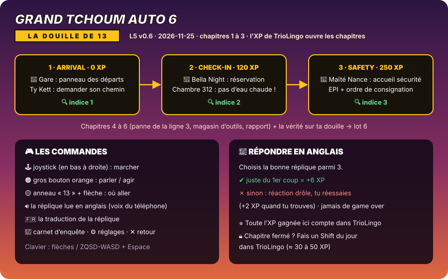

# Grand Tchoum Auto 6 · « La douille de 13 » · Guide
**Outil :** Grand Tchoum Auto 6, mode mystère de TrioLingo Industrial Edition Pro Max · **Version :** L5 v0.6 (chapitres 1 à 3) · **Généré le :** 2026-11-25

## L'histoire en 2 lignes
Première mission à l'étranger à l'usine 6 de Tchoum City… et ta douille de 13 a disparu. Chaque lieu = une vraie situation en anglais + un indice.

## Jouer (4 étapes)
| # | Tu fais | Tu dois voir |
|---|---|---|
| 1 | TrioLingo → Accueil → **🔧 Mode mystère**. | Le titre GRAND TCHOUM AUTO 6 sur la ville au coucher du soleil. |
| 2 | **▶ Nouvelle partie** (ou Continuer). | L'histoire commence. Touche la bulle crème pour avancer. |
| 3 | Marche avec le **joystick** vers l'**anneau « 13 »** (la flèche en haut à gauche indique la direction et la distance). | Le gros bouton orange apparaît : « Lire le panneau », « Parler à… ». |
| 4 | Touche le **bouton orange**, lis, et **choisis ta réponse en anglais**. | ✔ vert et +XP, ou une réaction drôle et tu réessaies. |

> 🔊 = la phrase lue en anglais · 🇫🇷 = la traduction (⚙ Réglages : traduction toujours affichée).

## Les chapitres
| Chapitre | Lieu | Ce que tu pratiques | Ouvert à |
|---|---|---|---|
| 1 · Arrival | Gare | lire un panneau, demander son chemin, gauche / droite | 0 XP |
| 2 · Check-in | Hôtel Riverside | réservation, demande polie (*Could I…?*), signaler un problème | 120 XP |
| 3 · Safety first | Portail de l'usine 6 | EPI, *must / mustn't*, ordre de consignation | 250 XP |
| 4 à 6 | Usine | panne, magasin d'outils, rapport… et la vérité | lot 6 |

## Questions fréquentes
| Question | Réponse |
|---|---|
| « 🔒 Encore X XP » ? | L'XP vient de TrioLingo : fais un Shift du jour (≈ 30 à 50 XP). L'XP gagnée dans le jeu compte aussi. |
| Pas de 🔊 dans les dialogues ? | Pas de voix anglaise installée : TrioLingo → ⚙ Options → Voix anglaise → **Aide**. |
| Je suis perdu·e ? | ⚙ → **Revenir à la gare**, ou suis la flèche jaune en haut à gauche. |
| Ma partie est-elle gardée ? | Oui, sur ce téléphone, toutes les 10 s et à chaque étape. L'export de TrioLingo (⚙ Options → Exporter) contient aussi la partie. |
| Ça rame ? | Le jeu affiche volontairement en basse résolution (style console 2000) pour rester fluide. Ferme les autres applis. |
