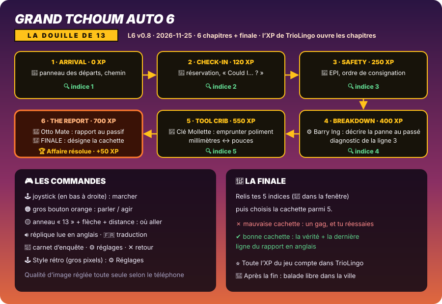

# Grand Tchoum Auto 6 · « La douille de 13 » · Guide
**Outil :** Grand Tchoum Auto 6, mode mystère de TrioLingo Industrial Edition Pro Max · **Version :** L6 v0.8 (6 chapitres + finale) · **Généré le :** 2026-11-25

## L'histoire en 2 lignes
Première mission à l'étranger à l'usine 6 de Tchoum City… et ta douille de 13 a disparu. 6 situations réelles du métier en anglais, 5 indices, et à la fin : à toi de trouver où elle est.

## Jouer (4 étapes)
| # | Tu fais | Tu dois voir |
|---|---|---|
| 1 | TrioLingo → Accueil → **🔧 Mode mystère**. | L'écran titre, avec « L6 v0.8 » tout en bas. |
| 2 | **▶ Nouvelle partie** (ou Continuer). | L'histoire commence. Touche la bulle crème pour avancer. |
| 3 | Marche avec le **joystick** vers l'**anneau « 13 »** (la flèche en haut à gauche indique la direction et la distance). | Le gros bouton orange : « Parler à… ». |
| 4 | Touche le **bouton orange**, lis, et **choisis ta réponse en anglais**. | ✔ vert et +XP, ou une réaction drôle et tu réessaies. |

## Les 6 chapitres
| Chapitre | Lieu | Ce que tu pratiques | Ouvert à |
|---|---|---|---|
| 1 · Arrival | Gare | lire un panneau, demander son chemin | 0 XP |
| 2 · Check-in | Hôtel Riverside | réservation, demande polie (*Could I…?*), signaler un problème | 120 XP |
| 3 · Safety first | Portail de l'usine 6 | EPI, *must / mustn't*, ordre de consignation | 250 XP |
| 4 · Breakdown | Ligne 3 (dans la cour) | décrire une panne au passé, diagnostic | 400 XP |
| 5 · Tool crib | Magasin d'outils | emprunter poliment, millimètres ↔ pouces, comparer | 550 XP |
| 6 · The report | Bureau maintenance | rapport d'intervention au passif, **finale** | 700 XP |

> La barrière de l'usine se lève quand l'accueil sécurité est terminé.

## La finale
1. Otto Mate te demande où est ta douille.
2. Choisis la cachette parmi 5. Tu peux **📒 relire tes 5 indices** dans la même fenêtre.
3. Mauvaise cachette = un gag, et tu réessaies. Bonne cachette = la vérité, puis la dernière ligne du rapport en anglais.
4. **🏆 Affaire résolue · +50 XP**. Ensuite, tu peux continuer à te promener dans Tchoum City.

## Questions fréquentes
| Question | Réponse |
|---|---|
| « 🔒 Encore X XP » ? | L'XP vient de TrioLingo : fais un Shift du jour (≈ 30 à 50 XP). L'XP gagnée dans le jeu compte aussi. |
| Pas de 🔊 dans les dialogues ? | Pas de voix anglaise installée : TrioLingo → ⚙ Options → Voix anglaise → **Aide**. |
| Je suis perdu·e ? | ⚙ → **Revenir à la gare**, ou suis la flèche jaune en haut à gauche. |
| Ça saccade ? | Attends 5 secondes : la qualité baisse toute seule. ⚙ Réglages affiche la qualité et le nombre d'images par seconde. |
| Ma partie est-elle gardée ? | Oui, sur ce téléphone. L'export de TrioLingo (⚙ Options → Exporter) contient aussi la partie. |
