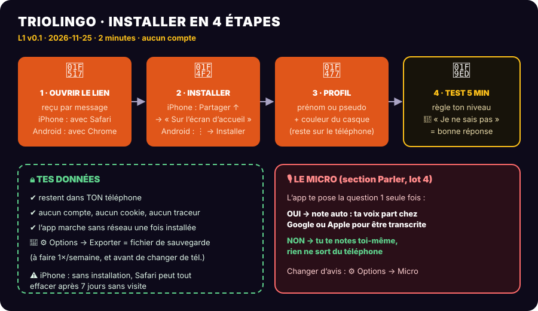

# TrioLingo · Guide d'installation
**Outil :** TrioLingo Industrial Edition Pro Max · **Version :** L1 v0.1 · **Généré le :** 2026-11-25

## Ce qu'il te faut
- Un téléphone **iPhone (Safari)** ou **Android (Chrome)**.
- Le lien de l'app, reçu par message : `<LIEN_REÇU_PAR_MESSAGE>`.
- 2 minutes. Aucun compte, aucune adresse e-mail.

## Installer (4 étapes)
| # | Tu fais | Tu dois voir |
|---|---|---|
| 1 | Ouvre le lien. **iPhone : avec Safari** (pas avec l'appli qui t'a envoyé le message). | Le logo TRIOLINGO et une barre qui monte jusqu'à 100 %. |
| 2a | **iPhone :** touche **Partager** (carré avec une flèche ↑), puis **« Sur l'écran d'accueil »**, puis **Ajouter**. | Une icône orange « 13 » sur ton écran d'accueil. |
| 2b | **Android :** touche **⋮** en haut à droite, puis **« Installer l'application »**. | Une icône orange « 13 » dans tes applis. |
| 3 | Ouvre l'app **depuis l'icône**, touche **« Touche pour commencer »**, écris ton prénom ou un pseudo, choisis la couleur de ton casque. | Ton avatar avec son casque. |
| 4 | Touche **« Continuer »** puis **« Commencer le test »** (5 min). | À la fin : ton radar de compétences et +50 XP. |

> 🤷 Pendant le test, **« Je ne sais pas »** est une bonne réponse : ça règle ton niveau plus juste que de deviner.

## Si ça coince
| Problème | Solution |
|---|---|
| Pas de bouton « Sur l'écran d'accueil » (iPhone) | Tu n'es pas dans Safari. Copie le lien, colle-le dans Safari, recommence l'étape 2a. |
| « Aucune voix anglaise installée » | ⚙ Options → Voix anglaise → **Aide** : le guide t'explique comment télécharger une voix. Ferme puis rouvre l'app. |
| L'app affiche encore l'ancienne version | Ferme complètement l'app, puis rouvre-la (1 à 2 fois). |
| « Sauvegarde abîmée » au démarrage | Rien n'est perdu : une copie de secours est gardée. ⚙ Options → Importer ton dernier fichier de sauvegarde. |

## Garder tes progrès
- Ils sont **seulement dans ton téléphone**. Personne d'autre ne les voit.
- **Une fois par semaine** (et avant de changer de téléphone) : ⚙ Options → **💾 Exporter**. Le fichier s'appelle `TrioLingo_Sauvegarde_AAAA-MM-JJ.json`.
- Nouveau téléphone : installe l'app, crée un profil, puis ⚙ Options → **📂 Importer** ce fichier.

## Le micro (arrive au lot 4)
La première fois que tu utiliseras « Parler », l'app te demandera si tu veux une **note automatique**.
- **Oui** : ton navigateur envoie ta voix à Google (Android) ou Apple (iPhone) pour la transformer en texte.
- **Non** : tu t'enregistres et tu te notes toi-même. Rien ne sort du téléphone.

Tu peux changer d'avis quand tu veux : ⚙ Options → Micro.
