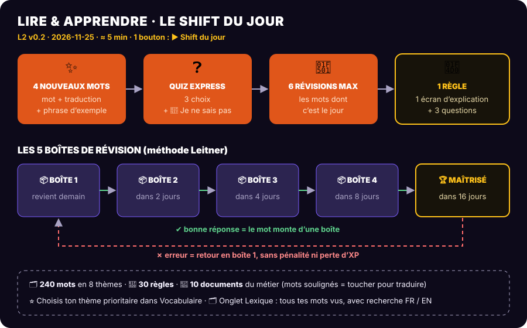

# TrioLingo · Lire & apprendre
**Outil :** TrioLingo Industrial Edition Pro Max · **Version :** L2 v0.2 · **Généré le :** 2026-11-25

## Le plus simple : 1 bouton par jour
| # | Tu fais | Tu dois voir |
|---|---|---|
| 1 | Accueil → **📖 Lire & apprendre**. | 4 boutons et tes 5 boîtes de révision. |
| 2 | Touche **▶ Shift du jour**. | « Étape 1 / 12 » et une barre en %. |
| 3 | Nouveau mot : lis-le (🔊 pour l'entendre), puis **Je retiens ✓**. | Le mot suivant. |
| 4 | Quiz : touche la bonne réponse, ou **🤷 Je ne sais pas**. | Vert = c'est juste. Sinon la bonne réponse s'affiche, puis **Suivant**. |
| 5 | Règle : lis l'écran, puis **S'entraîner** (3 questions). | ✅ Règle validée quand les 3 sont justes. |
| 6 | Fin : **Terminer**. | Tes XP gagnés et 🔥 sur le jour dans Progrès. |

> ✕ en haut à gauche = quitter quand tu veux. Ce qui est fait est gardé.

## Pour aller plus loin
- **🗂 Vocabulaire** : choisis un thème (Sécurité, Mécanique, Électricité, Automatisme, Hydraulique, Outils, Production, Déplacement). **Apprendre 5 nouveaux mots** ou **Réviser ce thème**. ⭐ = thème prioritaire du Shift du jour.
- **📐 Règles** : 30 règles (grammaire, conjugaison, syntaxe). ○ pas commencée · ◐ en cours · ✅ validée.
- **📖 Lecture** : 10 documents du métier (bon de travail, consignation, rapport…). **Mot souligné = touche-le** pour la traduction.
- **🗂 Onglet Lexique** : tous tes mots vus, avec leur boîte (●●○○○) et une recherche en anglais ou en français.

## Questions fréquentes
| Question | Réponse |
|---|---|
| J'ai raté un mot, je perds des points ? | Non. Il retourne en boîte 1 et revient demain. Aucune perte d'XP. |
| Pas de 🔊 à côté des mots ? | Pas de voix anglaise sur le téléphone : ⚙ Options → Voix anglaise → **Aide**. |
| « Rien à faire ici » ? | Tout est à jour. Reviens demain, ou apprends un autre thème. |
| Anglais américain ou britannique ? | Américain. Quand le mot britannique est différent, il est noté 🇬🇧 (ex. wrench → UK : spanner). |
