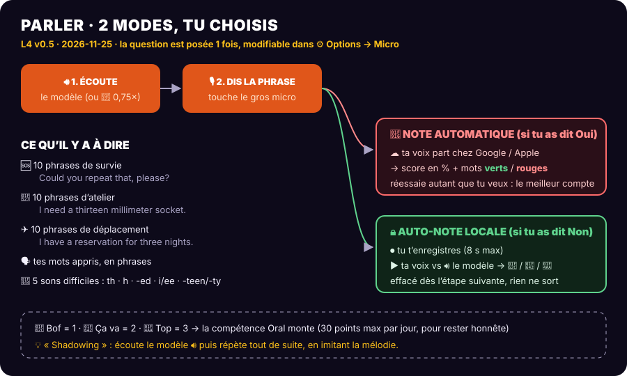

# TrioLingo · Parler
**Outil :** TrioLingo Industrial Edition Pro Max · **Version :** L4 v0.5 · **Généré le :** 2026-11-25

## La première fois : une question, une seule
Au premier essai, l'app te demande si tu veux une **note automatique** :
| Ta réponse | Ce qui se passe |
|---|---|
| **Oui, autoriser** | Ton navigateur envoie ta voix à Google (Android) ou Apple (iPhone) pour la transformer en texte. Tu obtiens un score en % et les mots reconnus en vert, les autres en rouge. Il faut du réseau. |
| **Non, 100 % local** | Tu t'enregistres, tu réécoutes ta voix à côté du modèle, et tu te notes : 😬 Bof · 🙂 Ça va · 💪 Top. Rien ne sort du téléphone, l'enregistrement est effacé dès l'étape suivante. |

Tu peux changer d'avis quand tu veux : 🎙 Parler → **Changer**, ou ⚙ Options → Micro.
Le téléphone peut aussi demander l'autorisation du micro : réponds **Autoriser**.

## Le plus simple : 1 bouton
| # | Tu fais | Tu dois voir |
|---|---|---|
| 1 | Accueil → **🎙 Parler** → **▶ Shift de parole**. | « Étape 1 / 5 », une phrase en anglais et sa traduction. |
| 2 | **🔊 Écouter** le modèle (🐢 pour plus lent). | La voix lit la phrase. |
| 3 | Touche le **gros micro** et dis la phrase. | Note automatique : le micro devient rouge, puis le score s'affiche. Auto-note : « Enregistrement… », retouche pour arrêter. |
| 4 | Note automatique : réessaie si tu veux, puis **Suivant**. Auto-note : **▶ Ma voix**, compare, puis choisis 😬 / 🙂 / 💪 et **Suivant**. | L'étape suivante. |
| 5 | **Terminer**. | Tes XP, et la compétence Oral sur le radar. |

## Les autres boutons
- **🆘 Phrases de survie**, **🔧 À l'atelier**, **✈️ En déplacement** : 10 phrases chacun. « Réussie » = 🙂 Ça va ou mieux.
- **🗣 Mes mots en phrases** : 5 phrases d'exemple avec les mots que tu as appris dans « Lire & apprendre ».
- **👄 Sons difficiles** : 5 phrases pour les sons qui piègent les francophones, avec une astuce à chaque fois.

## Si ça coince
| Message | Solution |
|---|---|
| « Le micro est refusé » | Réglages du navigateur → ce site → Micro → Autoriser. Puis rouvre l'app. |
| « Pas de réseau » | La note automatique a besoin d'Internet. Note-toi toi-même avec les boutons qui apparaissent. |
| « Je n'ai rien entendu » | Rapproche le téléphone, parle un peu plus fort, réessaie. |
| Pas de 🔊 | Pas de voix anglaise installée : ⚙ Options → Voix anglaise → **Aide**. |
